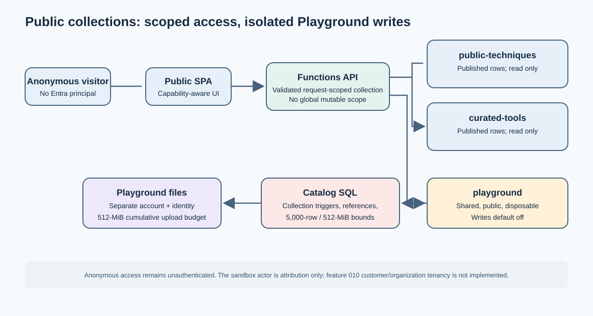

# Architecture and trust boundaries

The application supports a private Entra profile and an explicitly enabled anonymous
public profile. Public access is scoped to one selected collection per request; it does
not create an authenticated principal or establish customer/organization tenancy.

Start with one environment for this bootstrap app and its modest hosted sample.
Additional independent environments are optional, not a prerequisite or an enterprise
rollout plan. Each has its own configuration, identities and data resources.

In the authenticated configuration, one Azure/identity tenant can admit users from
multiple organizations and host multiple code-configured collections. Collection
capabilities and request authorization are shared mechanisms, not one deployment per
organization. There is no self-service membership, organization administration or
automatic per-organization isolation; adding such rules requires explicit code and
configuration changes. The anonymous sample is a separate configuration of this app,
with exactly two published read-only collections and one shared writeable Playground.



[Editable Mermaid source](diagrams/public-playground-architecture.mmd).

## Collection request flow

The public profile exposes exactly three collection IDs:

| Collection | Access |
|---|---|
| `public-techniques` | Published reads only |
| `curated-tools` | Published reads only |
| `playground` | Shared, public, disposable content; writes require the separately reviewed opt-in |

REST authorization, persistence, MCP discovery/execution and the UI use the validated
request-scoped collection capability. A request cannot inherit a collection from a
previous request or switch collections through a body field. Published/curated rows and
files are not writable through Playground capabilities.

Anonymous requests remain anonymous. The sandbox uses an explicit catalog actor for
attribution with null Entra identifiers; it does not fabricate token claims. Existing
private Entra authorization and feature-specific permissions remain separate.

## Optional private collection membership

Authentication is selected per deployment: public mode stays anonymous; private mode
still requires the cryptographically validated delegated Entra access token, audience,
scope and human `(tid, oid)` identity. There is no anonymous fallback after failed
private authentication. Optional collection grants further restrict private access;
they do not authenticate tokens or provision identities/permissions.

Set `CollectionAuthorization:Enabled=true` and configure exactly one admitted Entra
tenant. The following JSON shows the configuration shape with synthetic identifiers;
use your own registered API, tenant, group IDs and app-role values. Existing Entra
audience/scope/resource settings remain required.

The private deployment path supplies those settings from `infra/entra/registration.json`,
`allowedTenantId`, and `galleryBaseUrl` in `infra/main.bicep`. Keep `galleryBaseUrl` equal
to the origin MCP clients use so OAuth resource metadata matches the public endpoint.
When it is empty, metadata uses the direct Function App origin. The Microsoft tenant
is denied by default; `-AllowMicrosoftTenant` is an explicit opt-in and does not bypass
the configured tenant allowlist.

```json
{
  "Entra": {
    "AllowedTenantIds": "11111111-1111-4111-8111-111111111111"
  },
  "CollectionAuthorization": {
    "Enabled": true,
    "TenantId": "11111111-1111-4111-8111-111111111111",
    "Collections": {
      "public-techniques": {
        "ReadRoles": "Gallery.Reader"
      },
      "curated-tools": {
        "ReadGroups": "aaaaaaaa-aaaa-4aaa-8aaa-aaaaaaaaaaaa",
        "WriteRoles": "Gallery.Publisher"
      }
    }
  }
}
```

In Functions application/local settings, use flattened string keys such as
`CollectionAuthorization__Collections__curated-tools__WriteRoles=Gallery.Publisher`.
Each collection accepts `ReadRoles`, `WriteRoles`, `ReadGroups` and `WriteGroups`
as comma-separated strings. Roles match the exact, case-sensitive `roles` claim;
group GUIDs match the `groups` claim. A write grant includes read access but does not
bypass existing item ownership/admin/concurrency rules or the independent MCP write
switch. Do not assign a publisher role to ordinary visitors.

Only claims on the validated `GalleryBearer` identity in the configured tenant
count. Missing/unmapped claims, an unmapped collection, a foreign tenant and a
generic admin role without a collection grant are denied. Group overage markers,
display names, email, request headers and body fields confer no membership; there
is no automatic Graph lookup. For group overage, use an explicitly mapped app role
or review a separate membership-resolution implementation.

An unrecognized key, invalid group, empty grant, multiple admitted tenants or a
public-mode/private-grant conflict fails configuration at startup. Omitting the
entire section (or specifying only `Enabled=false`) preserves the existing private
profile; partially configured grants cannot silently fall back to it. Enabled
policies deny users with no mapped collections before handlers execute. REST and
MCP delegated handlers then recheck the selected collection and operation.
`/api/session?collectionId=...` returns the selected collection's write capability;
the browser hides authoring for read-only grants and the API remains authoritative.
The browser's shared HTTP client adds the selected `collectionId` to session
bootstrap too. With grants enabled, an unscoped session request is denied; start
readers at a mapped collection URL, for example `/?collectionId=curated-tools`.

The configuration represents organization-owned collections by assigning different
groups/roles to different installed collection IDs. It does not create organizations,
duplicate a collection ID per organization, accept a caller-selected organization,
or isolate two organizations deliberately granted the same collection. The bootstrap
currently has the three fixed collection IDs above; custom collection IDs, membership
administration and database-level private multi-tenant isolation are not implemented.

### Curated publication uses reviewed import packages

There is no hosted publisher policy, worker, frontend, SQL role or deployment template
in this release. The owner exports and reviews a package, then an independently
authorized operator imports it into an explicitly chosen destination. The local
catalog importer validates collection references and shared field contracts, refuses
populated collections, supports transactional dry runs and records idempotent receipts.
Reviewed publication is an explicit importer option, not an anonymous request permission.
See [manual publication](public-demo-deployment.md#manual-publication).

The public source profile uses a separate curated storage account and dedicated reader
identity. Public curated attachment uploads and deletes are refused; the Playground
writer cannot be reused for curated files. Ordinary private collection authorization
remains available and is separate from public publication.

The reviewed Playground SQL policy confines writes to unpublished Playground records
and its reserved sandbox actor, rejecting cross-collection references. Do not make the
anonymous principal `db_owner`, remove its guards, or broaden its data permissions to
import curated content. Source tests do not establish deployed grants or storage access.

## Storage and authoring

Playground file operations use a separate storage account, dedicated container and identity,
with a durable cumulative upload budget. The SQL policy
artifacts constrain writes and cross-collection references at the database layer as well
as in the API. Public write admission and storage/database changes are opt-in and must be
reviewed before activation; their presence in source does not prove that they have been
applied.

Workflows remain catalog documents containing ordered steps. The Workflow composer
returns a proposal only. Saving or adding an item uses the ordinary collection-scoped
authoring flow after human review; generated content is never committed automatically.
Neither catalog workflows nor their steps are executed as agents.

## Deployment and validation boundaries

Customer membership administration and cross-tenant data isolation are future work,
not shipped functionality. A collection ID alone is not a tenant boundary.

Local tests and template compilation do not establish live SQL trigger/grant behavior,
Blob role isolation, anonymous write readiness or deployed acceptance. See the
[Playground validation index](playground-validation.md) for what was and was not verified.
