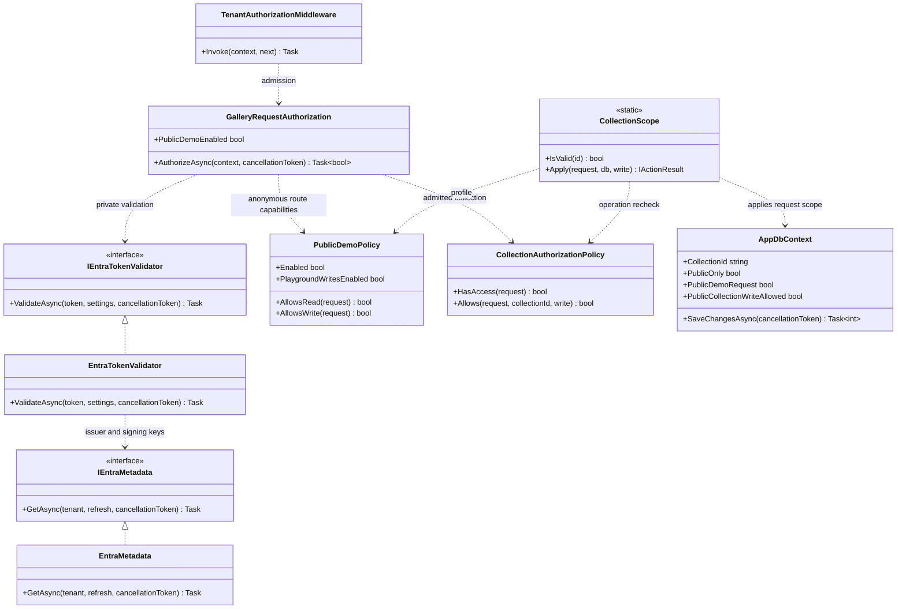
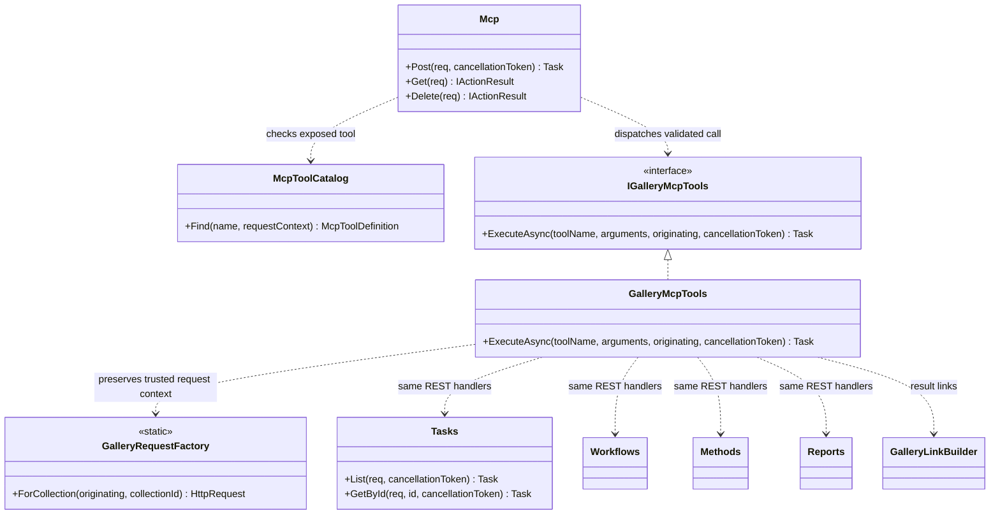
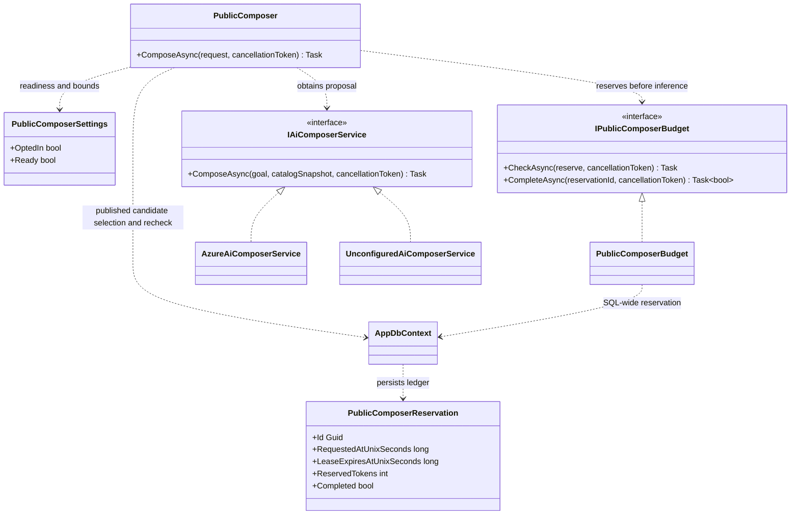

# Level 4: code

[Architecture tour](../../architecture.md) | [Next: runtime walkthroughs](dynamic.md)

**Learn:** zoom into selected Level 3 components until their actual types and
interfaces become visible. Code views are intentionally selective: authentication,
collection persistence and proposal isolation carry more architectural information
than a complete diagram of every DTO.

These diagrams show relevant members, not complete declarations. `..>` means
"uses"; `<|..` means "implements". Services injected by the host are dependencies,
not objects that each request constructs manually.

## Request identity and collection scope

Read the first chain as **admission**, then the second as **operation scope**.
Entra validation requires the admitted tenant, v2 issuer, RS256 signature,
audience, lifetime, delegated scope and human `(tid, oid)` identity; app-only
tokens do not become users. Untrusted `tid` only permits early denial and choosing
metadata for an already admitted directory, never a trusted identity assertion.

`AppDbContext` is scoped in dependency injection. Its query filters depend on the
request's collection and publication state. SaveChanges stamps new collection
records, rejects collection reassignment, and blocks unauthorized public writes
and public identity mutations. Filters are application invariants, not proof
that a runtime SQL principal has least privilege.

## MCP delegation

The adapter deliberately does not contain a parallel `AppDbContext` query path.
It translates validated arguments into handler requests and projects handler
results. A missing item becomes a tool error, not an empty success. Public
tool arguments must repeat the transport's collection. Private tools also require
an explicit collection and preserve the validated principal for handler checks.

## Proposal and durable budget

`Program.cs` selects the configured inference implementation or an explicitly
unconfigured implementation. Public Composer sets the selected collection and
published-only context, validates model-returned task/target pairs and rechecks
publication after inference. Its SQL writes are **budget reservations**, not
catalog documents. Failed/uncertain inference retains the charge; no automatic
refund or retry hides consumption.

**Evidence:** [middleware](../../../api/src/Middleware/TenantAuthorizationMiddleware.cs),
[request authorization](../../../api/src/Services/Auth/GalleryRequestAuthorization.cs),
[identity validator](../../../api/src/Services/Auth/EntraTokenValidator.cs),
[scope](../../../api/src/Services/CollectionScope.cs),
[data context](../../../api/src/Data/AppDbContext.cs),
[MCP types](../../../api/src/Services/Mcp),
[public Composer](../../../api/src/Services/PublicComposer.cs),
[budget](../../../api/src/Services/PublicComposerBudget.cs),
[inference interface](../../../api/src/Services/IAiComposerService.cs).
