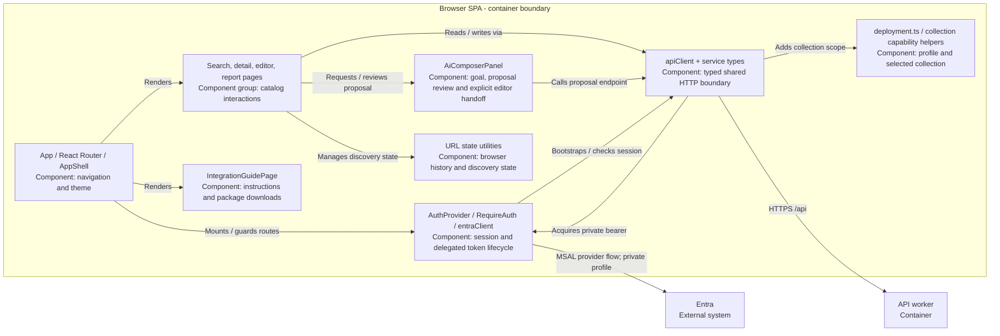
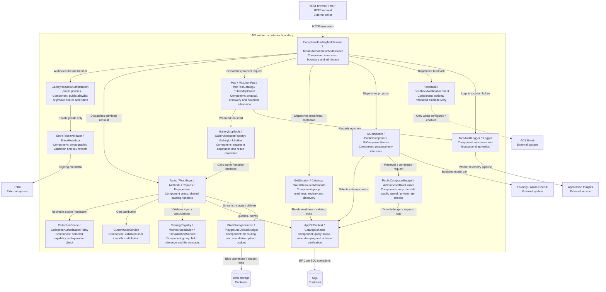
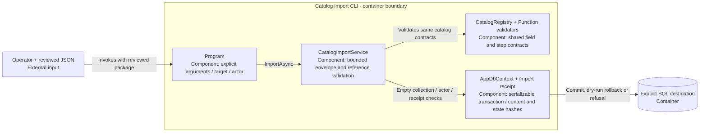

# Level 3: components

[Architecture tour](../../architecture.md) | [Next: code](code.md)

**Learn:** components describe responsibility inside a container. Three diagrams
zoom into the three application containers from Level 2. SQL and provider boxes
remain outside those boundaries. A component grouping can span several files;
it does not imply a separate package, process or service.

## Browser SPA

The AuthProvider/client arrows describe runtime collaboration, not a new token
service. Build-time public mode omits token acquisition; the server must still
confirm the matching public capability. Editor routes and controls hide writes
for read-only capabilities, but only the API can authorize a mutation.
Reauthentication preserves mounted drafts and does not replay failed requests.

## API worker

### Responsibility map

| Component | Invariant worth teaching |
|---|---|
| Admission middleware | Direct and proxied HTTP calls use the same application gate; HTTP trigger `Anonymous` does not mean unrestricted private API |
| Request authorization | Never turns failed private authentication into public access; metadata provider failure is not a successful sign-in |
| CollectionScope | Resolves and reapplies capability to the selected operation; public published queries do not expose unpublished rows |
| Catalog handlers | REST and MCP reach the same field checks, references, ownership/admin rules and persistence |
| MCP adapter | Rejects invalid arguments and public transport/tool collection mismatch; does not trust caller-created user claims |
| AppDbContext | Filters selected collection and publication; stamps added collection-bearing rows and refuses reassignment |
| File service | Routes by capability, validates prefixes, refuses isolated curated writes and stages unique attachment paths |
| Composer | Uses allowed catalog context and returns a proposal; never creates a workflow as part of inference |

## Import CLI

The importer is out-of-band, not a hidden hosted publisher. Its verified scope is
methods/tasks/workflows JSON; attachment bytes need a separately authorized
publication process. A dry run rolls back. A populated or edited destination is
not silently reset to make an import succeed.

**Evidence:** [frontend source](../../../frontend/src/App.tsx),
[AiComposerPanel](../../../frontend/src/components/AiComposerPanel.tsx),
[AuthProvider](../../../frontend/src/auth/AuthProvider.tsx),
[worker composition](../../../api/src/Program.cs),
[Function handlers](../../../api/src/Functions),
[services](../../../api/src/Services),
[MCP adapter](../../../api/src/Services/Mcp/GalleryMcpTools.cs),
[CLI service](../../../api/src/Services/CatalogImportService.cs).
