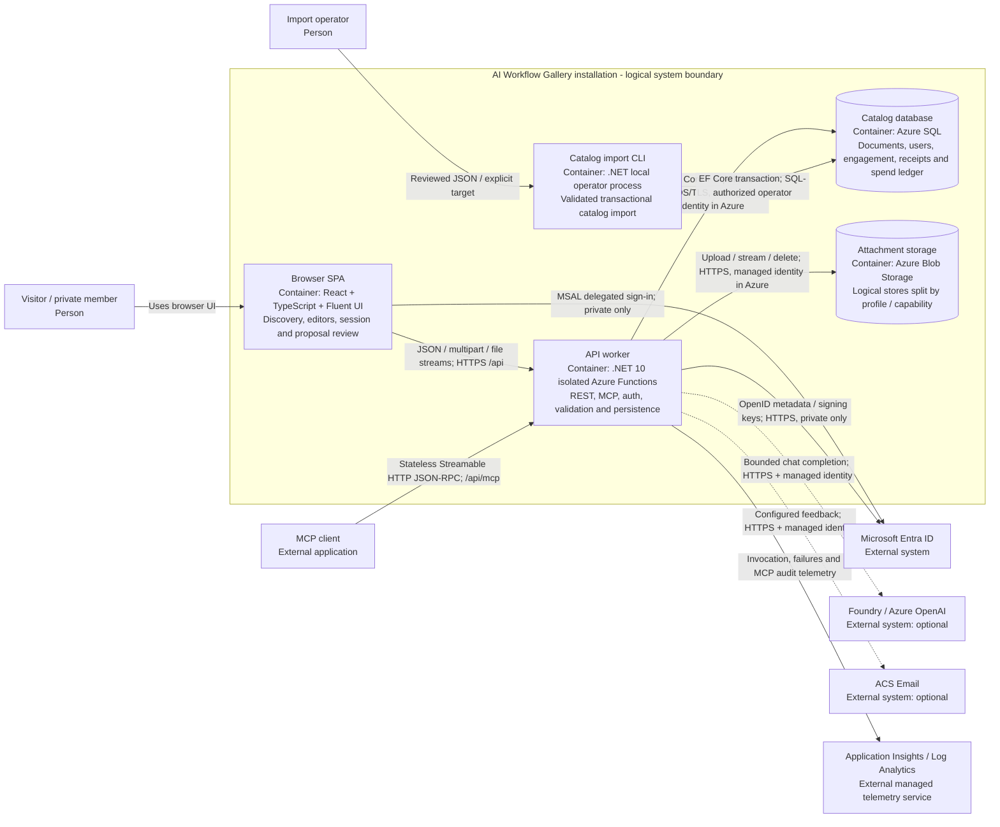

# Level 2: containers

[Architecture tour](../../architecture.md) | [Next: components](components.md)

**Learn:** a container is a separately running program or a data store. The SPA
runs in the user's browser; the API runs in Azure Functions. "Auth service",
"MCP service" and "Composer service" are not additional deployed microservices.

## Container contracts

| Container | Owns | Does not own |
|---|---|---|
| SPA | Routes, URL-backed discovery state, typed requests, capability presentation, draft-preserving reauthentication and human proposal review | Security decisions, SQL access, Blob credentials or model credentials |
| API worker | Authoritative request authorization; shared REST/MCP handlers; validation, persistence, file streaming and inference mediation | Agent execution, organization provisioning or hosted publication |
| SQL | Catalog relationships, identity attribution, concurrency state, import receipts, public Composer reservations; reviewed optional SQL guards | Blob bytes or Entra credential issuance |
| Blob stores | Attachment bytes; Playground cumulative budget blob when configured | Catalog metadata, per-user authorization or atomic SQL/Blob transactions |
| Import CLI | Bounded package validation and atomic methods/tasks/workflows import into an empty collection | Browser authoring, general backup restore, Blob-file publication or remote schema initialization |

The storage box is logical aggregation, expanded in Deployment: public source
templates separate runtime/general files, curated-reader files and Playground
files into accounts. Ordinary private installs use their configured file store.
This aggregation is not permission to share public and private storage.

Static Web Apps serves the SPA files and links `/api` to the Function App; it is
a deployment node, not another business-logic container. Direct Function requests
still pass the worker authorization boundary. Functions host/package storage is
operational storage and is shown separately at deployment level.

## Key choices

The system is a browser client plus one modular API worker, not a microservice
mesh. MCP reuses handlers rather than a second database query implementation.
No queue, background workflow scheduler, vector database or distributed cache is
required by the inspected application. Optional AI failure leaves manual catalog
use available when the database and authorization service are healthy.

**Evidence:** [SPA composition](../../../frontend/src/App.tsx),
[typed HTTP client](../../../frontend/src/services/apiClient.ts),
[worker wiring](../../../api/src/Program.cs),
[data context](../../../api/src/Data/AppDbContext.cs),
[Blob interface](../../../api/src/Services/BlobStorageService.cs),
[import executable](../../../datasets/public-techniques/import/Program.cs).
