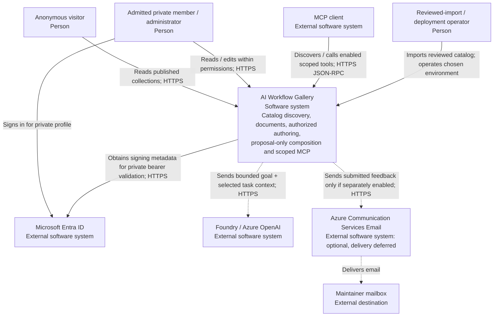

# Level 1: system context

[Architecture tour](../../architecture.md) | [Next: containers](containers.md)

**Learn:** draw one box for the gallery and ask what crosses its boundary.
Everything inside that box is omitted at this level. "Supports workflows" means
stores and explains ordered catalog documents, not runs an autonomous agent fleet.

## Responsibility and trust

| Boundary | What crosses it | What is checked |
|---|---|---|
| Person/client -> public gallery | Collection ID, search/input, optional proposal goal | Exact public route/capability, publication filter, request bounds |
| Person/client -> private gallery | Delegated bearer token, collection and operation | Signature, issuer, lifetime, audience, admitted tenant, scope, human identity; then collection and item permissions |
| Gallery -> model | Goal and server-selected task snapshots | Feature readiness, context bounds, budget/rate controls and output references |
| Operator -> import tooling | Reviewed JSON package and chosen SQL target | Schema/registry, existing actor, collection references, empty destination, receipt/hash and transaction |
| Gallery -> feedback service | Validated feedback submission if enabled | Runtime opt-in and configured endpoint/sender/recipient; no delivery promised for this release |

Anonymous requests remain anonymous. The optional sandbox actor is catalog
attribution with null Entra identifiers, not token impersonation. Collection IDs
partition application queries; they do not establish customer tenancy. The
optional private membership policy maps validated groups/roles within one
configured identity tenant, with no self-service organization administration.

## Non-goals visible at this level

No hosted curated publisher, automated content publication, workflow execution,
automatic Graph membership lookup, customer provisioning, cross-tenant data
isolation or implicit access to linked services. A private administrator's item
permissions do not override an enabled collection membership policy.

**Evidence:** [authorization contract](../../architecture.md#optional-private-collection-membership),
[request boundary](../../../api/src/Services/Auth/GalleryRequestAuthorization.cs),
[token validation](../../../api/src/Services/Auth/EntraTokenValidator.cs),
[importer](../../../api/src/Services/CatalogImportService.cs),
[feedback handler](../../../api/src/Functions/Feedback.cs).
