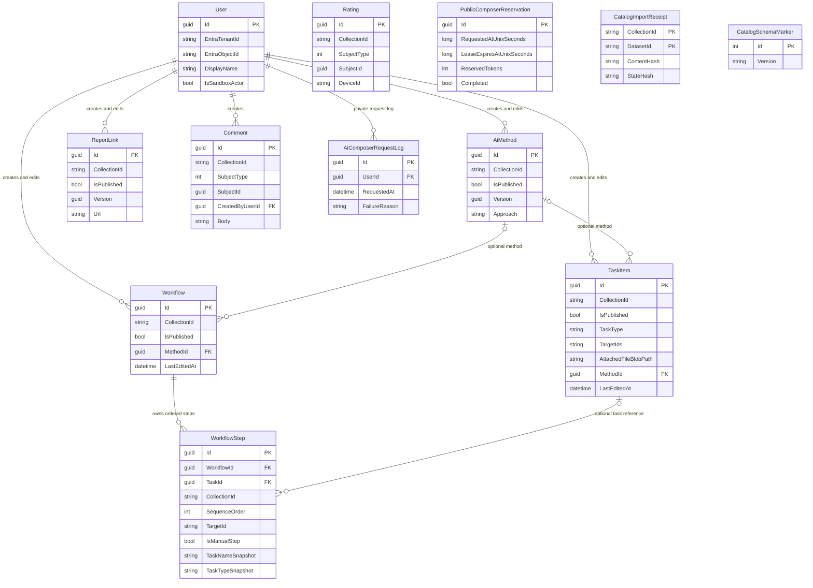

# Supporting view: data and consistency

[Architecture tour](../../architecture.md) | [Next: operations and decisions](operations.md)

**Learn:** C4 containers tell you that SQL exists, not what it owns. This data
view explains identity, relationships, publication and consistency. It describes
the published catalog schema family, not the retained legacy private database.

## Relational core

The diagram omits many descriptive fields and the separate created/edited user
foreign keys for readability. Types are conceptual storage representations.
Comments/ratings use a polymorphic `(CollectionId, SubjectType, SubjectId)`
reference checked by handlers; there is no direct relational foreign key from
`SubjectId` to all three possible subject tables. No invented Collection or
Organization table is hidden behind the diagram.

## Invariants

| Concern | Enforcement / consequence |
|---|---|
| Collection | Fixed installed IDs validated by application; collection-bearing rows filtered/stamped; row reassignment refused |
| Publication | Public curated reads require `IsPublished`; Playground documents remain unpublished under reviewed optional SQL policy |
| Task kind/target | CatalogRegistry validates task kind, target and workflow-step compatibility; registry is shared metadata, not executable code |
| Workflow order | Unique `(WorkflowId, SequenceOrder)`; steps may reference a task or describe a manual action |
| Task deletion | Referencing step survives with nullable TaskId and snapshots; workflow deletion cascades its own steps |
| Method association | Optional FK on task/workflow, restrictive delete, handler checks same collection |
| User identity | Unique `(EntraTenantId, EntraObjectId)`; display name is presentation, not authentication |
| Sandbox actor | At most one reserved sandbox user; null Entra fields; ordinary anonymous reads do not create users |
| Rating | Unique collection/subject/device key prevents accumulating duplicate votes; DeviceId is not a directory identity |
| Import | Composite receipt key `(CollectionId, DatasetId)` plus content/state hashes; changed contents or edited state refuse reimport |
| Schema | Compatibility marker plus read-only verification; marker alone is not permission to migrate |

## Concurrency is not uniform

Methods and report links use a `Version` value configured as an EF concurrency
token. Tasks and workflows use optional `expectedLastEditedAt` handler checks;
the task comparison allows 1 ms for SQL precision. Omitting the expected
timestamp retains legacy last-write-wins behavior. Do not describe every catalog
write as a rowversion-protected atomic compare-and-swap.

Unique user identity and sequence/rating keys enforce important database
invariants. Public Composer takes a database-wide application lock in a short
transaction before reservation. These locks are not held during model inference.

## Data beyond SQL

Attachment metadata/path lives in SQL; bytes live in Blob. A new upload receives
a unique staged path. SQL/Blob consistency is compensated, not transactional
across services. Download flows through an authorized API stream, not direct
browser SQL/Blob credentials.

Playground's `.upload-budget` counter is a conditionally updated Blob using
ETags; it is cumulative across workers and is not refunded. Its scope differs
from SQL's public Composer daily request/token ledger. Neither budget is an
invoice, per-user entitlement or guarantee against every Azure cost.

Report URLs and task links are references to providers, not replicas of those
providers' protected data. Task inline content, files and proposal goals should
be treated according to the selected installation's data policy; shared public
Playground must not contain sensitive/private data.

**Evidence:** [EF mapping and filters](../../../api/src/Data/AppDbContext.cs),
[entity declarations](../../../api/src/Models),
[task concurrency and deletion](../../../api/src/Functions/Tasks.cs),
[workflow handlers](../../../api/src/Functions/Workflows.cs),
[registry contract](../../catalog-core.md),
[upload budget](../../../api/src/Services/PlaygroundUploadBudget.cs),
[schema verification](../../../api/src/Data/CatalogSchema.cs).
