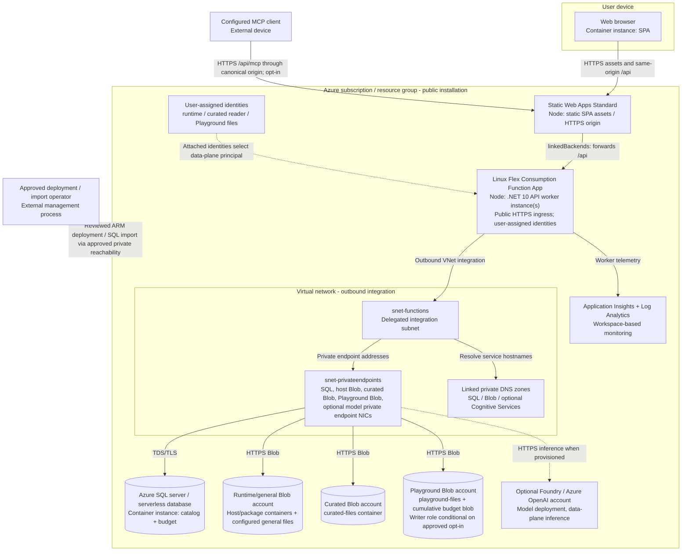
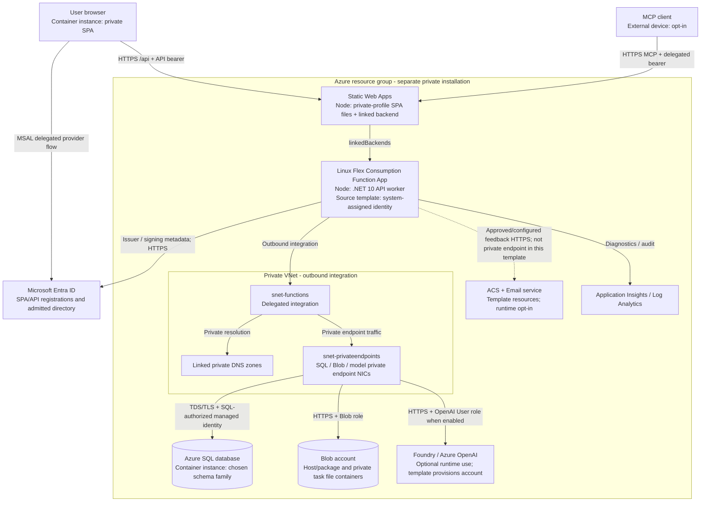
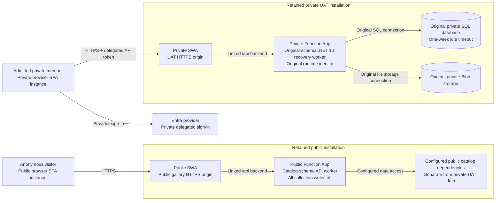
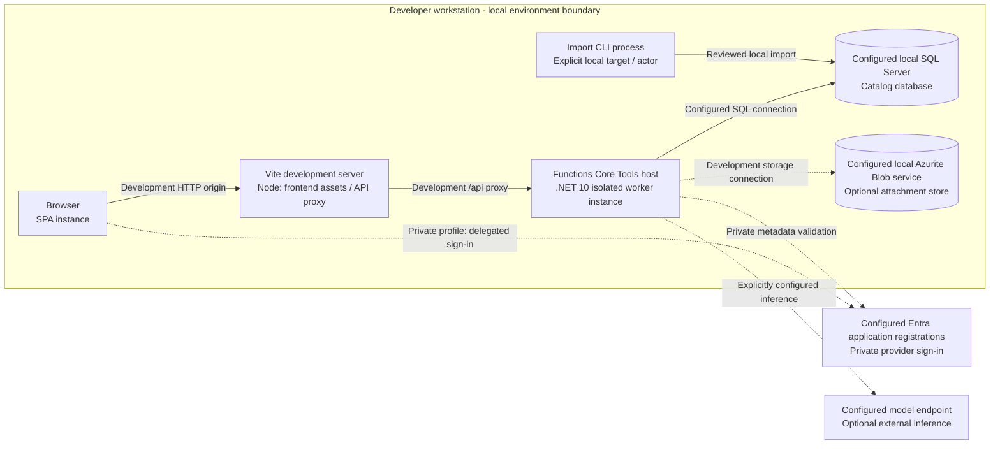

# Deployment views

[Architecture tour](../../architecture.md) | [Next: data model](data.md)

**Learn:** deployment maps Level 2 containers onto machines, managed services and
network nodes. A private endpoint is a network interface in your VNet; Azure SQL
and Storage remain managed services outside it. VNet integration controls the
Function App's outbound path, not automatic private-only HTTP ingress.

The diagrams are source-template deployment views, followed by the observed
release differences. They deliberately do not assert template defaults equal
the retained live installations.

## Public source-template topology

### Identity and network layers

| Principal / node | Source-template relationship | Boundary |
|---|---|---|
| Runtime identity | Function host/package Blob role; explicit managed-identity SQL connection; conditional OpenAI User role | Runtime operations, SQL grants and inference; SQL permission is separately provisioned, not inferred from ARM RBAC |
| Curated reader identity | Blob Data Reader scoped to `curated-files` in its own account | Curated file reads only; API also refuses isolated curated upload/delete |
| Playground file identity | Container-scoped reader, conditional Blob Data Contributor | Does not reuse curated credentials; writes require separate protections |
| Private endpoints + DNS | SQL, each configured Blob account, optional model | Data-plane network reachability; not user authentication or SQL privilege |
| Public Function ingress | Explicitly enabled in public Function module | Worker policy remains authoritative even if caller bypasses SWA |
| Operator | Approved Azure access plus SQL principal and private network reachability | Management/import access is not given to anonymous runtime users |

Template public deployment uses Sweden Central for runtime/data and East US 2
for the SWA resource. The Function template allows up to 40 instances of 2048 MB
with no always-ready instances. Those are source settings, not measured capacity
or a production SLA. Storage accounts and SQL disable public data access; the
model account, when provisioned, uses a private endpoint and keyless inference.
NSG association parameters do not create an egress firewall or its rules.

Model capacity provisioning does not itself enable public Composer. Complete
settings, inference access and the SQL budget ledger are independent
prerequisites. Playground account provisioning does not itself activate writes.
The public installer is a fresh-install preview/apply flow; it is not a safe
update tool for an existing private installation.

## Private source-template topology

An API token and a managed identity are different principals. The token says
which human may perform an operation; the managed identity lets the already
authorized worker access its backing services. Neither browser nor MCP client
receives the worker's SQL/Blob identity.

`infra/main.bicep` provisions model and communication resources even when their
runtime features are disabled; do not read an account's presence as evidence of
inference or email readiness. Always-ready HTTP instances are explicitly
parameterized; the private source Function maximum is 100 instances. These
defaults do not override the live UAT's retained settings.

## Observed release deployment differences

| Concern | Public gallery at release | Retained private UAT at release |
|---|---|---|
| Purpose | Anonymous public catalog | Original authorized private gallery |
| Logical installation count | One | One; no communication with public SQL |
| Frontend | Public-profile SPA; polished desktop/mobile | Matching private-profile SPA; same layout corrections |
| Worker/schema | Public catalog-schema source family | Original-schema .NET 10 recovery worker; not interchangeable with public worker |
| Authentication | Anonymous capabilities | Restored delegated identity profile; user sign-in/read confirmed |
| Playground | Writes off; dedicated authoring stack not installed there | Not converted to the disposable sample profile |
| Composer | Proposal-only | Separately configured private feature |
| SQL idle timeout | Do not infer from UAT or this table | 10080 minutes (one week), database Online at final release check |
| Runtime identity | Deployment-specific; do not infer from source diagram alone | Original user-assigned runtime identity retained, despite generic private template's system-assigned identity |
| Feedback | Delivery deferred | Delivery not an acceptance claim for this release |

The temporary disposable sample used for one-byte attachment acceptance was
retired. Its successful lifecycle does not mean public-domain Playground
authoring is enabled, nor that all public-template identities/stores exist
on that domain.

**Known source/live distinction:** `infra/main.bicep`'s private entrypoint
parameter `sqlAutoPauseDelayMinutes` does not allow 10080, while the underlying
SQL module does support it and the live UAT setting was separately applied.
Some template parameter descriptions still refer to historical startup seeding.
Current `Program.cs` verifies the catalog schema and does not run automatic
migrations or seeding. These are documented distinctions, not changes made by
this architecture task.

### Release installation map

This observation-level map intentionally aggregates public dependencies instead
of presenting every optional source-template resource as deployed. There is no
third sample installation and no cross-installation data path. The detailed
source-template diagrams above explain the available network/identity topology;
they are not a fresh ARM/RBAC inventory.

## Local development deployment

This is a local arrangement, not an installer that silently provisions those
services. .NET SDK comes from `global.json`; Node/dependencies come from the
documented development prerequisites and lockfiles. Local credential mechanisms
differ from managed identities in Azure. Never reuse production data or publish
local settings. `--initialize-catalog` refuses remote SQL and requires a new empty
local database.

## Build, release and deployment plane

GitHub build/test jobs validate source; they do not constitute Azure data-plane
acceptance. SPA assets and API packages are built/deployed separately. The API
package lives in Functions deployment Blob storage; SWA hosts built static assets.
Frontend-only releases preserve the linked backend. ARM templates describe
resources, while SQL schema/grants/import are separately reviewed operations.
The public source intentionally excludes environment-specific deployment
identities/workflows: downloading it transfers no cloud access.

**Evidence:** [public entrypoint](../../../infra/public-demo.bicep),
[public worker](../../../infra/modules/public-demo-function.bicep),
[private entrypoint](../../../infra/main.bicep),
[private worker](../../../infra/modules/function-app.bicep),
[network](../../../infra/modules/network.bicep),
[private endpoints](../../../infra/modules/private-endpoint.bicep),
[SQL](../../../infra/modules/sql.bicep),
[storage](../../../infra/modules/public-demo-storage.bicep),
[model](../../../infra/modules/ai-foundry.bicep),
[development proxy](../../../frontend/vite.config.ts),
[release evidence boundaries](../../playground-validation.md),
[deployment runbook](../../public-demo-deployment.md).
