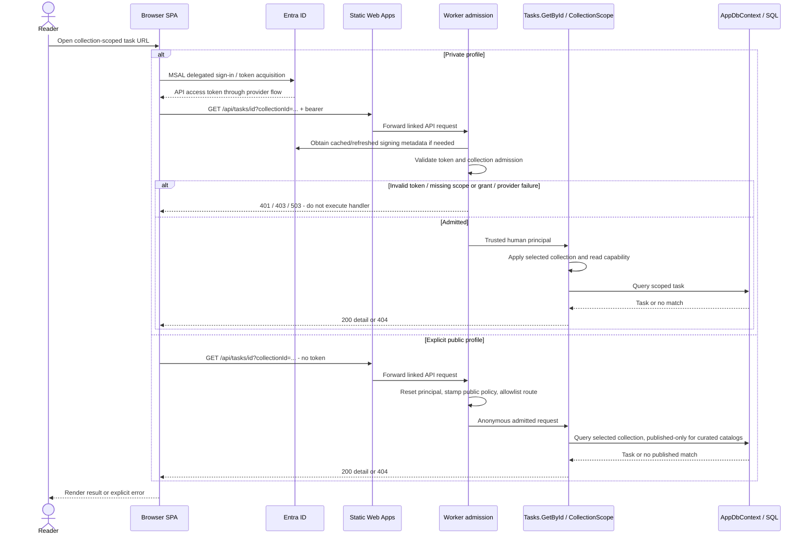
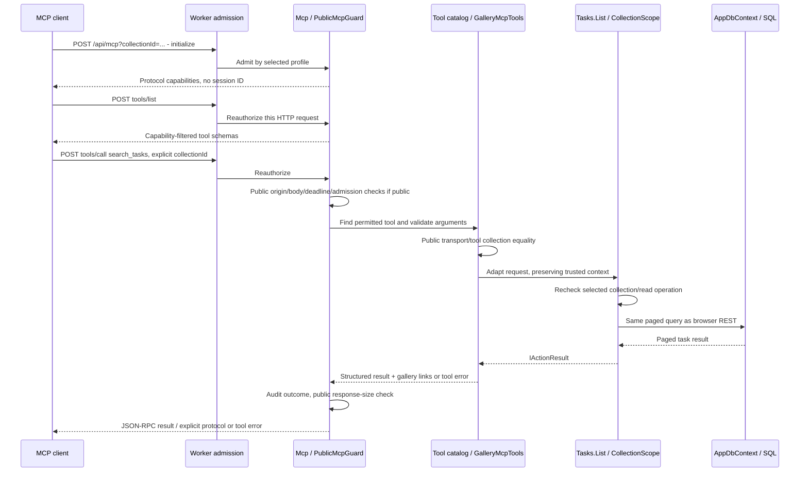
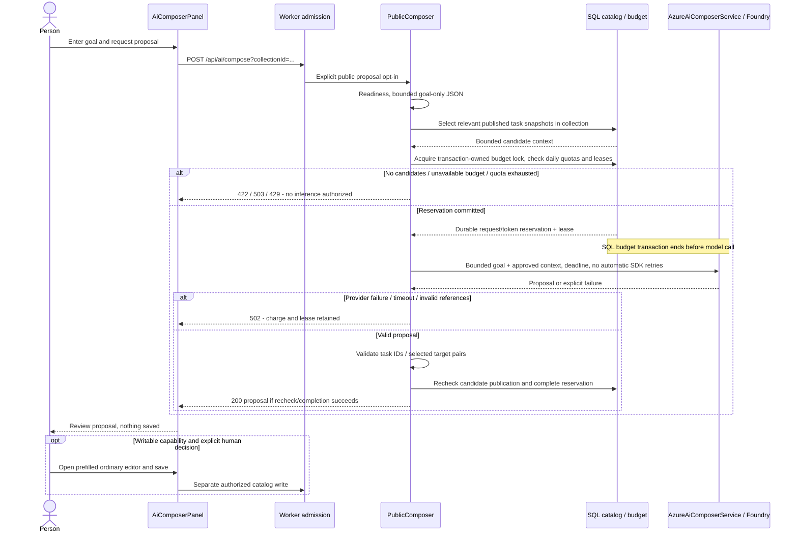
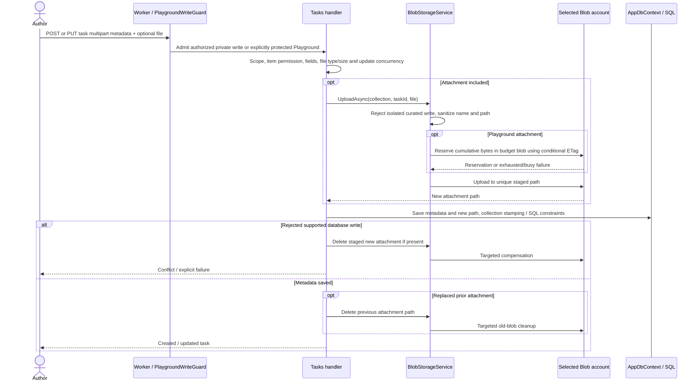
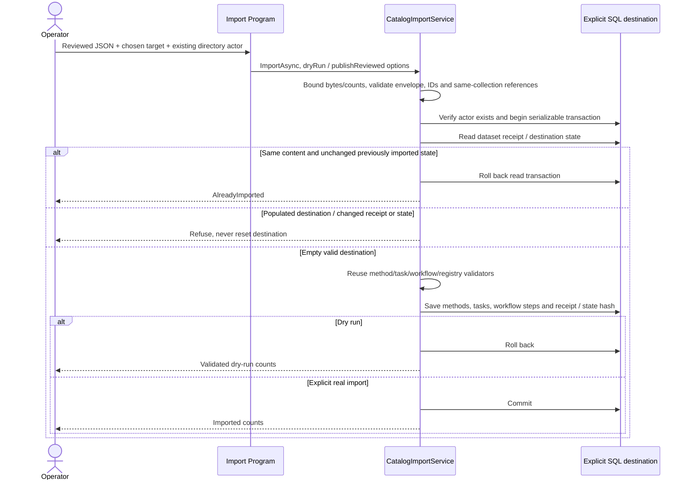

# Dynamic views: follow a request

[Architecture tour](../../architecture.md) | [Next: deployment](deployment.md)

**Learn:** static C4 arrows say who can collaborate. Dynamic views show the order,
decisions and failure paths for one scenario. These are implementation-derived
sequences, not claims that every branch was exercised on every live deployment.

## 1. Read a task: private and public profiles

A public collection ID cannot reveal a private installation: it only selects
within the current installation. Private expiry triggers a reauthentication
notice without dropping mounted drafts. Recovery rechecks the session, and the
person retries the operation; the client does not blindly replay a write.
Invalid/missing public collection selection is rejected, not replaced with a
cross-collection search.

## 2. An MCP read reuses the REST handler

Each POST stands alone: no SSE, server session or instance affinity.
GET explicitly declines a server event stream; DELETE has no server state to
remove. Disabled tools cannot be enabled by naming them in `tools/call`.
Public read tools number eight; the twelve catalog write tools are additionally
available only for a properly enabled Playground. Private writes have their own
independent MCP write switch plus ordinary authorization.

## 3. Public Composer: charge, infer, validate, propose

The completion/recheck path can also fail explicitly; it does not manufacture
a successful proposal after losing the budget store. Public runtime is
proposal-only; read-only collection capabilities prevent the editor handoff from
becoming authoring there. Private Composer uses its own per-user request-log
rate limiting and selected catalog snapshots, rather than this anonymous
database-wide budget flow.

## 4. Optional task attachment write and compensation

SQL and Blob are not one distributed transaction. Unique staging avoids
overwriting an old file before a metadata write succeeds; supported rejection
paths attempt targeted cleanup. Failures/crashes around either store can still
require operator reconciliation. Playground reservations are cumulative and are
never refunded, including after cleanup or uncertain uploads.

Task deletion snapshots references in surviving workflow steps, deletes the
attachment if present and saves the record/step changes. A later SQL failure
cannot undo an already deleted Blob. This is a real consistency trade-off, not
an architecture guarantee of atomic delete across two services.

## 5. Reviewed catalog import

`publishReviewed` sets publication state within this authorized import, not an
HTTP permission. The CLI does not create directory users or provision SQL
access. Owner-supplied packages must satisfy its contract; it is not a generic
overwrite/import-anything endpoint.

**Evidence:** [HTTP client](../../../frontend/src/services/apiClient.ts),
[auth recovery](../../../frontend/src/auth/AuthProvider.tsx),
[MCP transport](../../../api/src/Functions/Mcp.cs),
[MCP adapter](../../../api/src/Services/Mcp/GalleryMcpTools.cs),
[Composer](../../../api/src/Services/PublicComposer.cs),
[budget transactions](../../../api/src/Services/PublicComposerBudget.cs),
[task write lifecycle](../../../api/src/Functions/Tasks.cs),
[Blob routing](../../../api/src/Services/BlobStorageService.cs),
[import transaction](../../../api/src/Services/CatalogImportService.cs).
