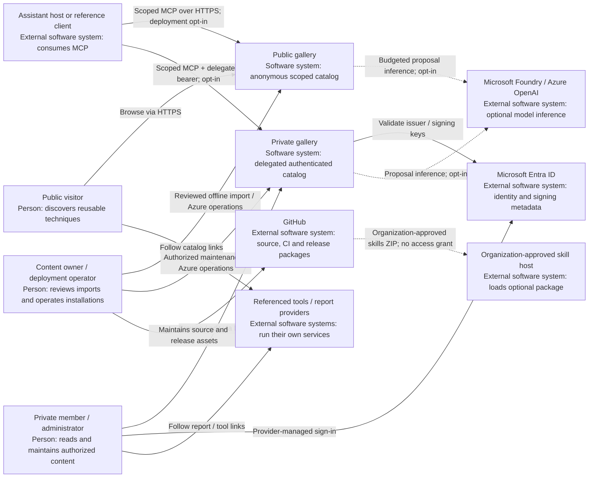

# System landscape

[Architecture tour](../../architecture.md) | [Next: system context](context.md)

**Learn:** a landscape places systems beside one another. It does not expose the
gallery's internal database or frontend; those belong at the next zoom levels.
The public gallery and a private installation have the same product purpose but
separate deployment-owned data, configuration and identities.

There is deliberately **no public-to-private gallery arrow**. A public collection
does not read another deployment's private SQL. A downloaded skill package is
instructions, not an identity, native connector, access grant or workflow runner.
No installation into an organization's skill host is implied by publication.

| Neighbor | Relationship | Responsibility that stays outside the gallery |
|---|---|---|
| Entra | Private human sign-in, access-token issuance, API signing metadata | Account lifecycle, guest admission, consent and Conditional Access |
| Foundry / Azure OpenAI | Optional chat-completion inference | Model hosting and inference; not execution of catalog workflows |
| GitHub | Source, automated checks and downloadable packages | Repository/account administration; not runtime catalog authorization |
| Referenced providers | User opens a link or supported report view | Provider sign-in, licensing and authorization; a catalog link grants none |
| Skill host / assistant | Imports instructions or explicitly configured MCP connection | Organizational clearance, tool approval and native client compatibility |

**Evidence:** [product contract](../../../README.md),
[client integration contract](../../connect-production-mcp-server.md),
[package privacy](../../package-privacy.md),
[integration manifest](../../../integrations/cowork-plugin/manifest.json).
